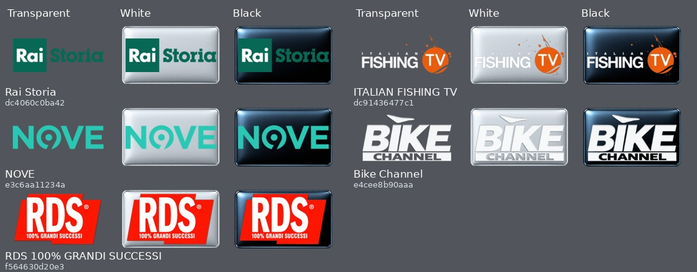

# DTT ITALIA a talianske feedy – kontrolná dávka 23. novembra 2026

**Stav pred vydaním.** Zostavených a overených je 27 archívov. Každá nová grafika má originál a 9 výsledných PNG. Z 96 kontrol White/Black pri 48 nových grafikách má 86 výsledok REVIEW a 10 PASS. Pri kolízii farieb s pozadím náhľad zachováva farebnosť značky. Konkrétne pri Italia Fishing TV slabne biely text na bielom podklade, pri Radio Classica na čiernom podklade tmavne časť logotypu. Balíky na tejto pracovnej vetve sú určené na kontrolu pred vydaním.

| Výber | Referencie v bouquetoch | Nové PNG naprieč 9 variantmi | Nahradené PNG | Zachované PNG zo starých balíkov |
| --- | ---: | ---: | ---: | ---: |
| DTT ITALIA | 285 | 2565 | 0 | 0 |
| 9°E | 439 | 9 | 399 | 18411 |
| 5°W | 260 | 0 | 102 | 13245 |

Rozmery sú 50×30, 220×132 a 400×240, pozadia Transparent, White a Black. Počty v stĺpcoch PNG zahŕňajú všetkých deväť variantov. Každý pôvodný člen mimo zmien má zhodný obsah. Katalóg obsahuje 507 balíkov a 2224 častí. SHA-256 spoločného manifestu je `40db67977de066be65fa8f37f5a73041aa1b337b7a5c9cdf40233edaf537094a`.

## Pôvod a porovnanie

- [Vlákno Azzurra](https://www.linuxsat-support.com/thread/157954-picons-dtt-italia-by-azzurra/) malo 10 strán a 183 príspevkov. Posledný bol zo 17. novembra. Vlákno ponúka jednotlivé aktualizácie. Z 483 príloh malo 480 názov končiaci na PNG. Pri dekódovaní boli tri z týchto súborov WebP. [Zoznam príloh s SHA-256](attachments.json).
- Nastavenia **Vhannibal Motor Dtt Italia 22 nov 2026** majú SHA-256 `b44bc9affcc9f9263f8a77fd9391387fa6865f15645fcef12a08462b8dad20de`. Z lamedb sa použili skutočné identifikátory služby, multiplexu, siete, typ služby a úplný namespace. Bouquety 01, 59/60 a 81/82 určujú taliansky rozsah. DTT používa 267 referencií s `EEEE0000` a 18 s `EEEE0272`. Na 9°E a 5°W sa zachovali aj pôvodné stanice mimo týchto bouquetov. SHA-256 porovnávacej sady Vhannibal Motor je `27e9ca4f15d62f00a1fa9365e69b702eb828dbee0d634f2495da3954f661bc8d`.
- Pre 885 z 984 väzieb sa použila existujúca deväťvariantová grafika Warder. Ďalších 99 väzieb používa 48 odlišných zdrojových grafík. [Matica referencií, dôkazov, zdrojov a kontrol MASTER V9](recipe.json). Pri Radio Classica TV sa použil originál od vysielateľa. [Radio Classica](https://www.radioclassica.fm/img/logo-radioclassica-mifi.png)
- [Výsledok zostavenia vrátane SHA-256 každého ZIP](build.json) a [skúšky oboch klientov](clients.json). FullHDGlass použil skutočný inštalátor pri 27 archívoch. PiconHub vykonal 54 inštalácií do dočasného adresára. Kontrola overila výber balíka, zhodu nainštalovaných PNG a ochranu cudzej pozemnej referencie. Aktualizovaný manifest prijali aj oba doterajšie validátory. Fyzický prijímač nebol súčasťou testu.

## Náhľady na kontrolu

Každá skupina zobrazuje Transparent, White a Black na rozmere 220×132. Originál a všetky tri rozmery sú v ZIP-e pod SHA zdroja v priečinku `artwork/`.




## Opätovné zostavenie

Vstupom je katalóg FullHDGlass v revízii `3597e077e7808997cc18542c6d57a8f1304f98d4` s časťami balíkov pre 9°E, 5°W a 13°E. Stavba pred použitím overí SHA-256 každého dielu a archívu. Príkazy sa spúšťajú z koreňa FullHDGlass, cesta `../PiconHub` odkazuje na sprievodnú zmenu PiconHubu.

```sh
python3 tools/build-dtt-italia.py --input ../povodny-katalog --output ../taliansky-kandidat --report ../zostavenie.json
python3 tools/test_dtt_italia_clients.py --hub ../PiconHub --channels ../taliansky-kandidat --report ../skusky-klientov.json
```

Odkazy v manifeste majú produkčný formát, ktorý kontrolujú oba klienty. Pred vydaním sa diely kontrolujú zo zhodnej revízie tejto vetvy. Hlásenia o nových príspevkoch Azzurra spracuje existujúci dvojtýždňový SAT skener PiconHubu.

## Nezávislé overenie uložených výsledkov

Z pracovnej revízie FullHDGlass `f903ec11c9ccbab0316894b5a152c1b9a1b77311` sa znova stiahlo všetkých 181 dielov. Pri každom sa overila dĺžka a SHA-256 a po ich spojení aj SHA-256 všetkých 27 archívov. Stiahnutý manifest bol bajtovo zhodný s lokálnym výstupom aj s kópiou v PiconHube `af01ddd3f10a87471f77b89ec100a845ccedbd26`. Druhé zostavenie z pôvodných vstupov dalo rovnaký manifest, index SHA256SUMS a report s 27 hashmi. Pri 220×132 majú talianske a existujúce SK/CZ sady vo všetkých troch pozadiach nula spoločných referencií.

Všetkých 241 testov PiconHubu prešlo. Prešli aj jeho GitHub kontroly balíka, OpenATV a OpenPLi. Katalógová regresia zachytáva zmenu akéhokoľvek z ostatných 480 balíkov a ich metadát. Dve kontroly FullHDGlass pôvodne očakávali presný odtlačok predchádzajúceho katalógu. Dostali odtlačky nezávisle overeného výsledku. Stav CI je pri [FullHDGlass #158](https://github.com/Evolution-by-Warder/FullHDGlass-Warder-Evolution/pull/158) a [PiconHub #87](https://github.com/Evolution-by-Warder/PiconHub-Warder-Evolution/pull/87).
