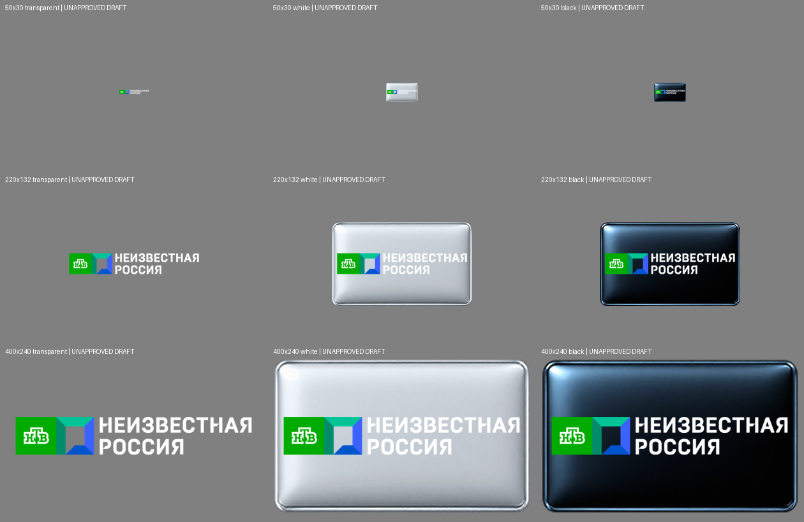

# Vhannibal – grafiky pripravené na samostatné schválenie

**Vlastník 8. 11. 2026 výslovne schválil všetkých šesť referencií a ich existujúce varianty. Všetkých 54 referenčných PNG je vložených do 18 pracovných ZIPov PR #50; produkčný merge nie je schválený.** Grafické schválenie a súhlas s produkčným merge sú dve samostatné rozhodnutia. Doteraz schválené PNG a všetky CANAL+ SK/CZ archívy zostávajú nezmenené.

| Skupina | Referencie | Jedinečné kontrolné PNG | Stav |
|---|---:|---:|---|
| BloombergHT HD | 2 | 9 | Oficiálne aktuálne čierne/biele SVG. Všetkých9hashov,rozmerov a alfy overených; živé SVG majú stále uloženéSHA256. Schválené vlastníkom 8. 11. 2026. |
| BETFRED TV1–3 | 3 | 27 | Už vytvorené V9návrhy boli obnovené bez zmeny všetkých27hashov. Starší checkered donor sa nepreberá. Schválené vlastníkom 8. 11. 2026. |
| SISSP / pôvodný SIS Racing | 1 | 9 | Originál viazaný na presnú referenciu zobrazuje SIS Racing. Skratku SP svojvoľne nerozvíjame na Spanish; vlastník schválil presne túto identitu a pripravený artwork. Existujúci V9návrh, nie nové vymyslené logo. |

Spolu45jedinečných variantov pre6referencií (po prijatí54referenčných PNG, pretože BloombergHT používa rovnakú sadu dvakrát). Pri každej sade sú rozmery50×30,220×132,400×240 a pozadiaTransparent,White,Black. **Predchádzajúci QC REVIEW nie je automaticky povýšený na schválenie.**

## BloombergHT

[SHA256,rozmery a aktuálne oficiálne podklady](bloomberght-review/check-20261108.json). Pri rastrových hranách sa24chromatických pixelov vrátilo na hodnoty pôvodnej farebnej kresby; nič sa nezamlčuje ani nenasadzuje automaticky.

## SIS Racing a BETFRED TV

[Presné referencie, dôvody pôvodného REVIEW a všetky hashové kontroly](sis-betfred-review/review.json). Z existujúceho menšieho artefaktu sa prevzalo24PNG;12chýbajúcich400×240 výstupov sa reprodukovalo z čerstvých pôvodných vstupov a každý má presne pôvodný indexovýSHA256. Z predchádzajúceho renderu sa nerobí nový vstup.

Dva TV5MONDE prípady, FUNBOX HD/UHD a nejasné identity zostávajú oddelené; tento prehľad ich neschvaľuje.

## Dávka07 – TV8 Turkey: nové návrhy čakajúce na schválenie

Oficiálny domáci TV8 originál z [ACUNMEDYA](https://www.acunmedya.com/en/home), nie TV8 International. Referencia `1_0_16_390_20D_73_2080000_0_0_0`. Pripravených9 variantov (50×30,220×132,400×240 × transparentné,biele,čierne). Pôvodné farby bez prekreslenia; nemenné Warder šablóny. Geometria a zväčšenie originálu216×195 sú súčasťou požadovanej kontroly.

[Kontrolné súčty a geometria](tv8-official-review/review/review.json) · [Oficiálny originál](tv8-official-review/acun-tv8.png)

**PENDING OWNER ARTWORK APPROVAL — žiadny variant nebol vložený do ZIPov.** Staršie schválenia sa nemenia.

SES a UNKNOWN RUSSIA: nové zdroje uchované v `ses-official-review/` a `unknown-russia-official-review/`; nejde o schválené picony a pre rozpor značiek nemajú nové varianty.

## 9.11.2026 – TV8 Turkey: schválených všetkých deväť variantov

Vlastník výslovne schválil všetkých9 pripravených PNG a ich zaradenie do pracovných balíkov. Schválenie sa vzťahuje na presné bajty z checkpointu91888de566185186d1d461097c7aa9365276546a (SHA256 v tv8-official-review/review/review.json). Vyššie označenie pending je historické. Dávka08 pridáva referenciu `1_0_16_390_20D_73_2080000_0_0_0` do deviatich520E ZIPov; TV8 Turkey, nie International. Žiadne prerenderovanie. Produkčné zaradenie ani merge nie sú schválené.

## Dávka09 – НТВ Неизвестная Россия / UNKNOWN RUSSIA – návrhy na kontrolu

Oficiálne oznámenie NTV28.9.2026 a aktuálny katalóg vlastníka Gazprom-Media potvrdzujú novú značku. Pripravených9 PNG z transparentného loga Cableman, vizuálne doloženého oficiálnym NTV obrázkom. Nejde o tvrdenie priameho stiahnutia transparentného PNG od vysielateľa.

**PENDING OWNER ARTWORK REVIEW. WHITE varianty zachovávajú pôvodný biely text a majú slabší kontrast; nie sú pripravené na automatickú integráciu.** Žiadne prefarbenie ani prekreslenie. Prvá referencia `1_0_1_43A6_EAC5_42E_1A40000_0_0_0` identitne doložená v predchádzajúcom checkpointe; druhá11012H ostáva podmienene blokovaná úplným aktuálnym DVB tuple.

[Proveniencia](unknown-russia-official-review/provenance.json) · [SHA256/rozmery/alfa](unknown-russia-official-review/review/review.json).0 uzavretých referencií,0 ZIP zmien,104 otvorených. AL-KAFEL má nový oficiálny nepriehľadný emblém uložený samostatne; logo Studio sa nepoužíva ako kanálový donor.

## 10.11.2026 – NTV Неизвестная Россия: všetkých9 PNG schválených

Vlastník výslovne schválil všetkých9 PNG dávky09 vrátaneWHITE bez prerábania. Presné bajty z checkpointu98ab9bf7a626d118cb69496c71af0bbe582f9b26 sú vložené do9 pracovných420E ZIPov pre `1_0_1_43A6_EAC5_42E_1A40000_0_0_0`. Staršie pending/contrast-hold označenia vyššie sú historické; schválenýWHITE sa nemení. Druhá11012H referencia stále blokovaná aktuálnym úplným DVB tuple. Vlastník zároveň schválil ďalšie bezpečné dávky a ich ukladanie bez jednotlivých schválení; závažné problémy identity/kvality zostávajú dôvodom odloženia. Produkčný merge nie je povolený.

## Dávka14 – Chefi.ro:9 nových návrhov na schválenie (10.11.2026)

Oficiálny AntenaPLAY originál, žiadne logoZU TV. Presná referencia `1_0_16_5_A_16E_1860000_0_0_0` je doložená dávkou13. Všetky tri rozmery ×TRANSPARENT/WHITE/BLACK sú pripravené bez prefarbenia a bez zmeny MASTER šablón. [Kontrolný náhľad](chefi-official-review/review/preview.png) a [technický report](chefi-official-review/review/review.json). Nový artwork čaká na výslovné vizuálne schválenie, zatiaľ nie je súčasťou ZIPov. Zostáva92 otvorených; kandidát45TV/402PNG/99ZIPov.

## Dávka14 – všetkých9 Chefi.ro PNG schválených a integrovaných –10.11.2026

Vlastník výslovne schválil všetkých9PNG vrátaneWHITE, bez prerenderovania či zmeny farieb,zlatých efektov,proporcií a priehľadnosti. Presné bajty z checkpointu e9d9b1b1c10ebcb026faab80dd29e1417b8f8fa2 vložené pre `1_0_16_5_A_16E_1860000_0_0_0` do9 pracovných390E ZIPov. Staršie pending označenia vyššie sú historické. Žiadne ďalšie aliasy ani nesprávny ZU TV donor.
