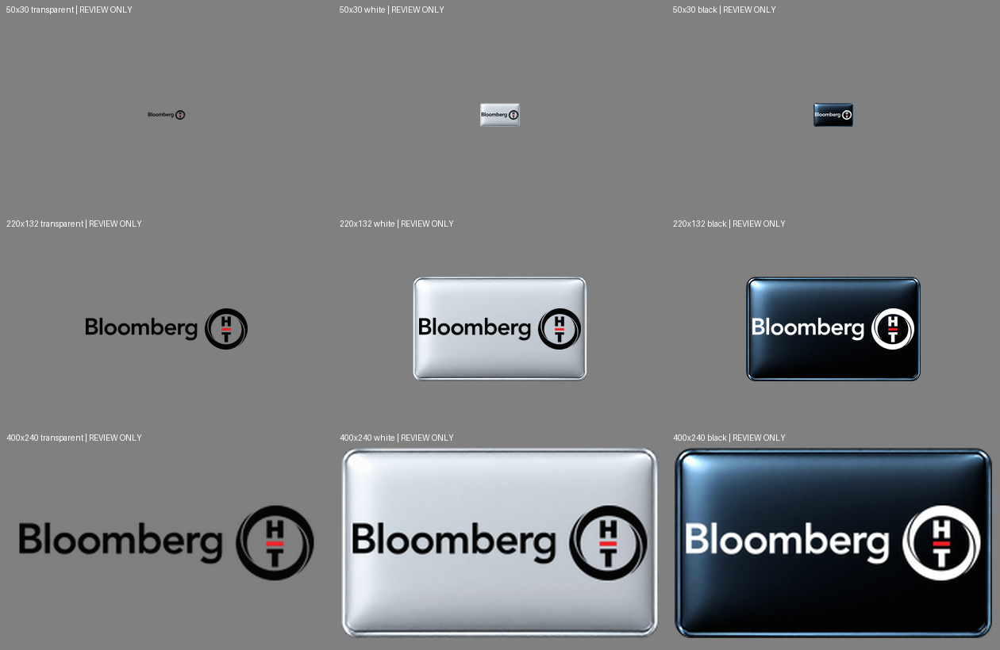
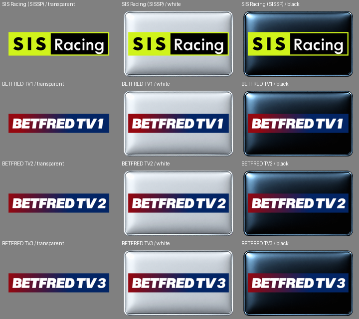
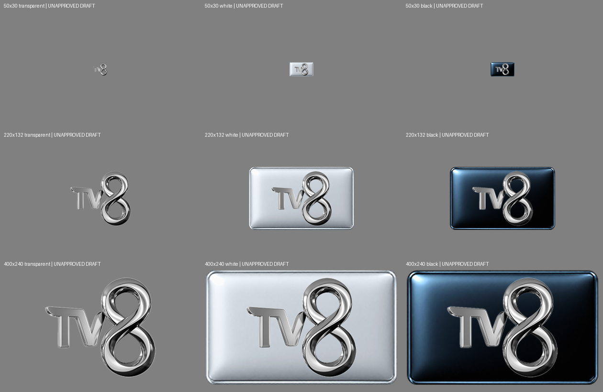

# Vhannibal – grafiky pripravené na samostatné schválenie

**Vlastník 8. 11. 2026 výslovne schválil všetkých šesť referencií a ich existujúce varianty. Všetkých 54 referenčných PNG je vložených do 18 pracovných ZIPov PR #50; produkčný merge nie je schválený.** Grafické schválenie a súhlas s produkčným merge sú dve samostatné rozhodnutia. Doteraz schválené PNG a všetky CANAL+ SK/CZ archívy zostávajú nezmenené.

| Skupina | Referencie | Jedinečné kontrolné PNG | Stav |
|---|---:|---:|---|
| BloombergHT HD | 2 | 9 | Oficiálne aktuálne čierne/biele SVG. Všetkých9hashov,rozmerov a alfy overených; živé SVG majú stále uloženéSHA256. Schválené vlastníkom 8. 11. 2026. |
| BETFRED TV1–3 | 3 | 27 | Už vytvorené V9návrhy boli obnovené bez zmeny všetkých27hashov. Starší checkered donor sa nepreberá. Schválené vlastníkom 8. 11. 2026. |
| SISSP / pôvodný SIS Racing | 1 | 9 | Originál viazaný na presnú referenciu zobrazuje SIS Racing. Skratku SP svojvoľne nerozvíjame na Spanish; vlastník schválil presne túto identitu a pripravený artwork. Existujúci V9návrh, nie nové vymyslené logo. |

Spolu45jedinečných variantov pre6referencií (po prijatí54referenčných PNG, pretože BloombergHT používa rovnakú sadu dvakrát). Pri každej sade sú rozmery50×30,220×132,400×240 a pozadiaTransparent,White,Black. **Predchádzajúci QC REVIEW nie je automaticky povýšený na schválenie.**

## BloombergHT

[SHA256,rozmery a aktuálne oficiálne podklady](bloomberght-review/check-20261108.json). Pri rastrových hranách sa24chromatických pixelov vrátilo na hodnoty pôvodnej farebnej kresby; nič sa nezamlčuje ani nenasadzuje automaticky.

## SIS Racing a BETFRED TV

[Presné referencie, dôvody pôvodného REVIEW a všetky hashové kontroly](sis-betfred-review/review.json). Z existujúceho menšieho artefaktu sa prevzalo24PNG;12chýbajúcich400×240 výstupov sa reprodukovalo z čerstvých pôvodných vstupov a každý má presne pôvodný indexovýSHA256. Z predchádzajúceho renderu sa nerobí nový vstup.

Dva TV5MONDE prípady, FUNBOX HD/UHD a nejasné identity zostávajú oddelené; tento prehľad ich neschvaľuje.

## Dávka07 – TV8 Turkey: nové návrhy čakajúce na schválenie

Oficiálny domáci TV8 originál z [ACUNMEDYA](https://www.acunmedya.com/en/home), nie TV8 International. Referencia `1_0_16_390_20D_73_2080000_0_0_0`. Pripravených9 variantov (50×30,220×132,400×240 × transparentné,biele,čierne). Pôvodné farby bez prekreslenia; nemenné Warder šablóny. Geometria a zväčšenie originálu216×195 sú súčasťou požadovanej kontroly.

[Kontrolné súčty a geometria](tv8-official-review/review/review.json) · [Oficiálny originál](tv8-official-review/acun-tv8.png)

**PENDING OWNER ARTWORK APPROVAL — žiadny variant nebol vložený do ZIPov.** Staršie schválenia sa nemenia.

SES a UNKNOWN RUSSIA: nové zdroje uchované v `ses-official-review/` a `unknown-russia-official-review/`; nejde o schválené picony a pre rozpor značiek nemajú nové varianty.
